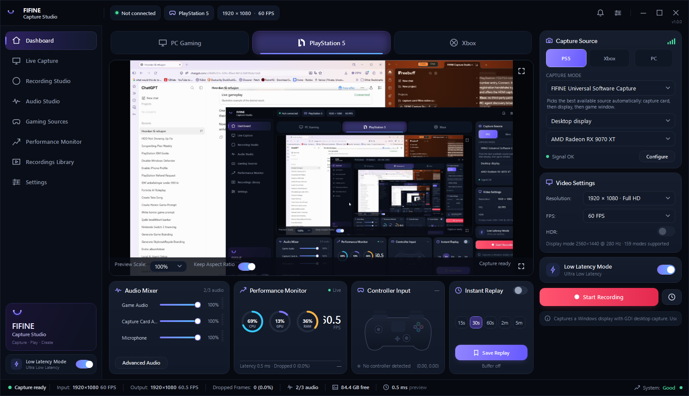
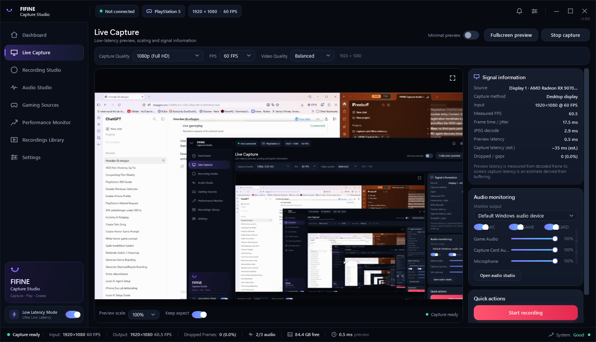
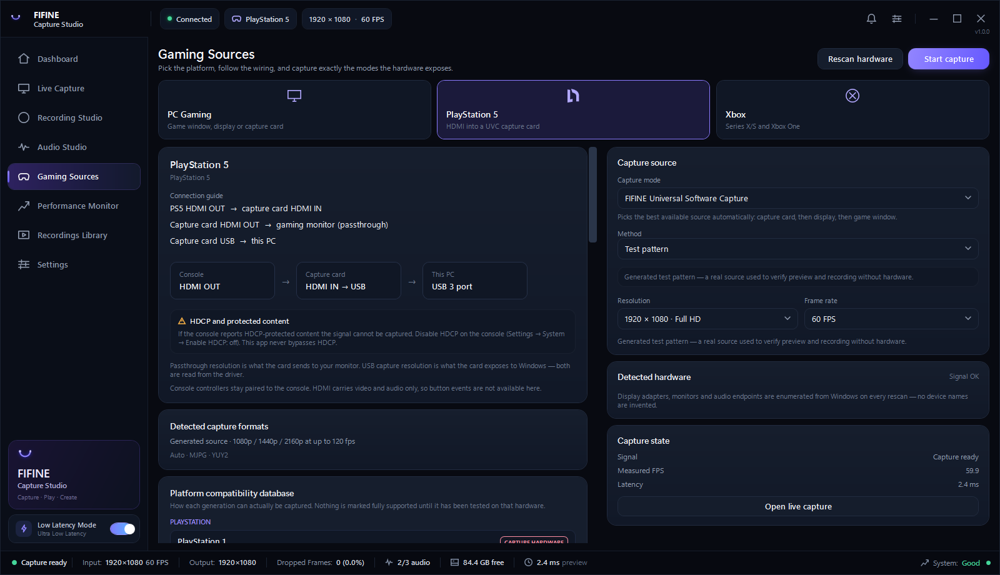
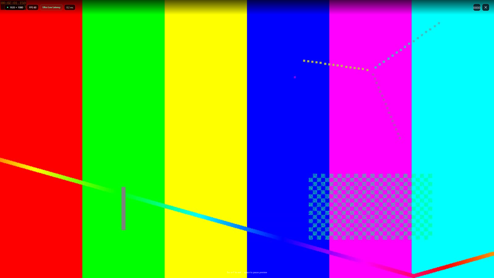
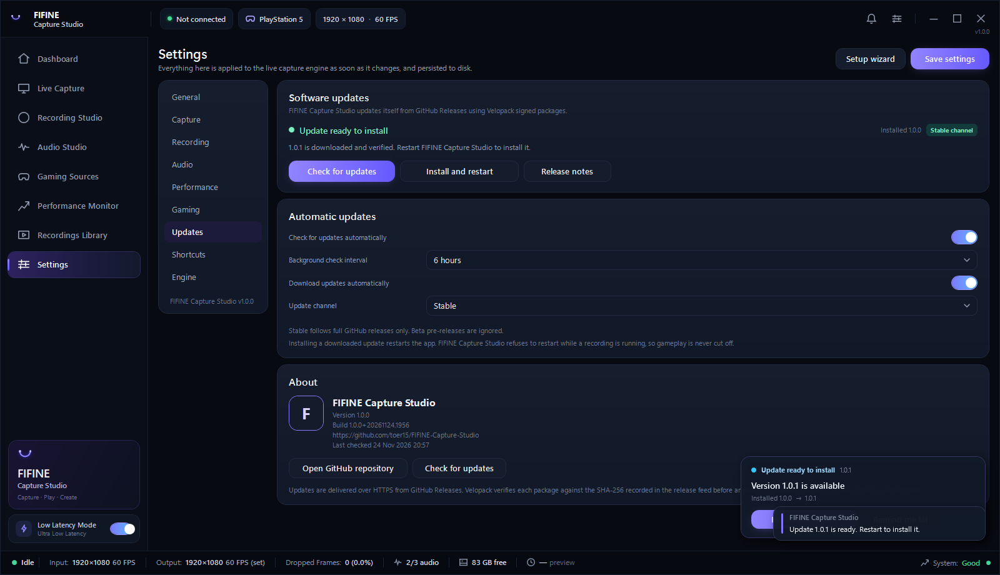
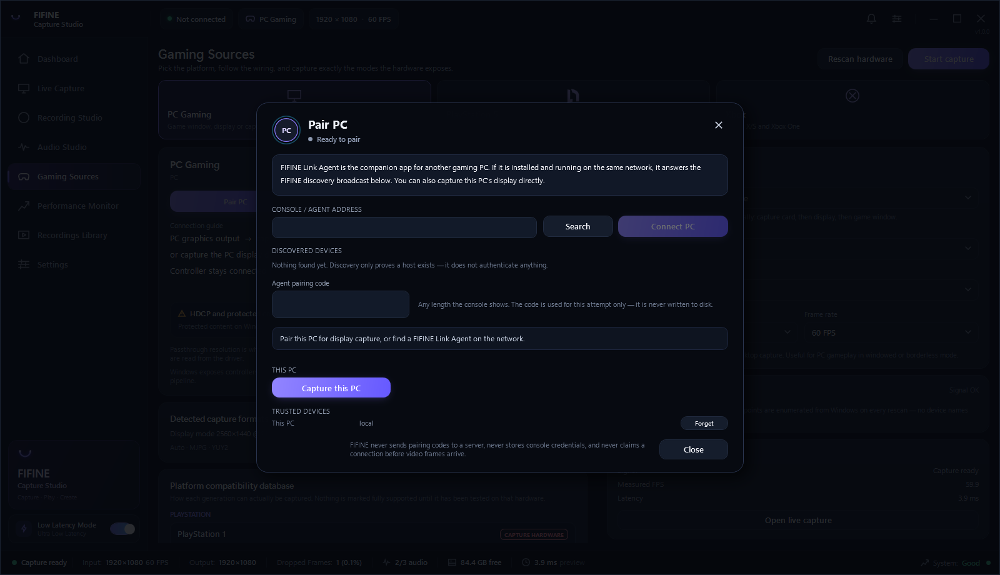
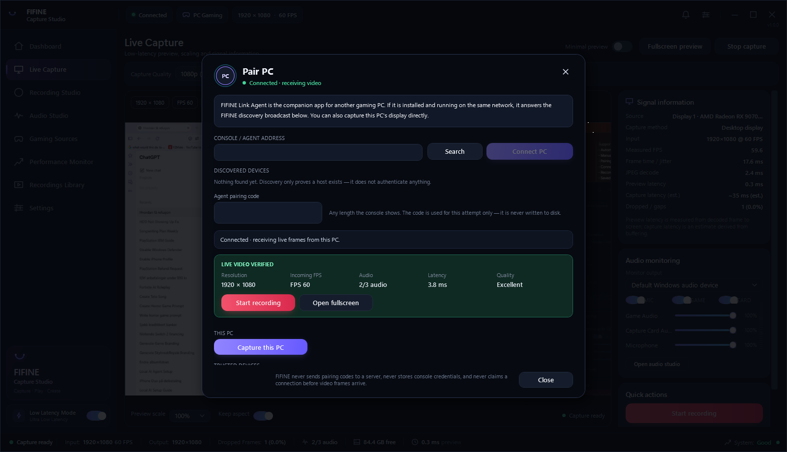

# FIFINE Capture Studio

A native Windows capture and recording studio for PC, PlayStation and Xbox gameplay.
Built with WPF on .NET 8, a real FFmpeg capture/encode pipeline, WASAPI audio mixing,
DirectShow device discovery and measured performance monitoring.

The app is gaming-first: connect a platform, preview with as little delay as the hardware
allows, record, save replays and watch performance. It is not a video-production suite.






## What it actually does

| Area | Implementation |
| --- | --- |
| Device discovery | DirectShow video/audio filters read from `HKCR\CLSID\{860BB310-…}` and `{33D9A762-…}`; monitor modes from `EnumDisplaySettings`; windows from `EnumWindows` |
| Capture formats | FFmpeg `-list_options true` against the real device, so only driver-reported resolutions/FPS appear |
| Video pipeline | One FFmpeg process per session: MJPEG preview on stdout + optional H.264/HEVC/AV1 record output + optional replay-ring output |
| Preview | In-app MJPEG splitter, JPEG decode on a dedicated thread, newest-frame-wins presentation on the WPF render thread |
| Encoding | Encoder list from `ffmpeg -encoders`, each candidate proven with a real 6-frame encode before it is offered (NVENC / AMF / Quick Sync / Media Foundation / x264 / x265 / SVT-AV1) |
| Recording | Part files encoded to MP4/MKV, graceful FFmpeg shutdown (`q`), concat via the concat demuxer with `-c copy`, `.fifine.json` sidecar, ffprobe metadata |
| Pause / resume | Finalises the current part safely, restarts preview, then continues into a new part that is concatenated on stop |
| Instant replay | `-f segment -segment_time 2 -segment_wrap N` ring in `%LOCALAPPDATA%\FifineCaptureStudio\replaybuffer`; saving concatenates the newest segments |
| Audio | WASAPI shared-mode capture and system loopback through NAudio, own float mixer, resampling to 48 kHz stereo, per-channel gain/mute/monitor/delay, true peak meters, PCM pushed to FFmpeg over named pipes |
| Monitoring | WASAPI render with drift compensation; the mix that is recorded is the mix you hear |
| Performance | `GetSystemTimes` for CPU, GPU Engine performance counters for GPU/encode utilisation, `GlobalMemoryStatusEx` for RAM, disk free space, measured frame gaps |
| Controllers | XInput (Xbox-compatible pads) and Sony HID reports (DualSense/DualShock 4) — observation only |
| Library | ffprobe metadata, generated thumbnails, search, filters, sort, rename, delete, reveal, play |
| Settings | JSON at `%LOCALAPPDATA%\FifineCaptureStudio\settings.json`, atomic writes, applied live |
| Capture modes | HDMI capture card, Universal Software Capture (picks card → display → window), FIFINE PC Network Capture, Console Network Capture, PC Direct Capture. Unavailable modes stay listed with the reason instead of being hidden |
| Capture quality | Auto / 480p / 720p / 1080p / 1440p / 2160p dropdown built from the source's real height. Sizes above the source are offered but flagged as upscaled, and the encoder does the scaling so passthrough and preview are untouched |
| FPS | Only rates the source reports are listed; 4K120 is never offered unless the driver exposes it |
| Video quality | Low / Balanced / High / Ultra / Custom, mapped to encoder presets and the existing bitrate estimator |
| Compatibility database | Per-generation PlayStation, Xbox and PC entries with connection methods, video source, modes, audio, state and limitations. Four states: FULLY SUPPORTED, OFFICIAL METHOD, EXPERIMENTAL, CAPTURE HARDWARE |
| Fullscreen preview | Separate borderless window on the target monitor, `Uniform` stretch, hover-revealed controls (exit, mute, resolution, FPS, recording timer, latency), `Esc` / `F` to leave, no pipeline restart |
| Live monitoring | Per-source monitor toggles (microphone, game, capture card), output device selection, independent monitor volume; monitoring is a separate render path and never adds audio to the recording |
| AMD AFMF | Real detection of the Radeon adapter, driver version and ADLX runtime. The toggle stays disabled with an explanation until an ADLX binding exists — it never fakes a driver change |
| Frame generation | Optional recording-only interpolation (`minterpolate`), 2X and 4X, capped by resolution and a 240 FPS ceiling; preview and console rendering are unaffected |

### Deliberately honest limitations

* **HDCP**: protected HDMI content cannot be captured. The UI says so and never attempts a bypass.
* **HDR**: no HDR path is implemented, so the HDR switch is disabled with an explanation instead of pretending.
* **Capture latency**: only the preview latency (decoded frame → WPF render pass) is measured. The capture-side figure is derived from buffering and labelled *estimated*. End-to-end controller-to-photon latency cannot be measured through HDMI and is not claimed.
* **Controller events**: a console controller paired with the console sends nothing over HDMI; the input monitor explains this and stays empty for console sessions.
* **Passthrough vs capture**: HDMI passthrough resolution is never used to advertise recording resolution; only driver-exposed capture modes are listed.
* **Upscaling**: the default is source resolution. Larger sizes can be selected, but the UI labels them as upscaled and states that no extra detail is captured.
* **Console network capture**: no PlayStation or Xbox generation exposes a sanctioned third-party API that hands console frames to a Windows app. The compatibility database marks every console as requiring capture hardware. Remote Play and the Xbox app are other vendors' features and are not presented as FIFINE technology.
* **FIFINE Link Agent**: the network-capture mode is visible but disabled in this build because the companion sender is not shipped. It is marked EXPERIMENTAL in the database rather than pretending to work.
* **AMD AFMF**: AFMF is a driver-level Radeon setting reachable only through AMD's ADLX SDK. No ADLX runtime ships with this build, so the setting reports "cannot be controlled" and refuses to flip. Advanced AFMF options are not shown at all.
* **Frame generation**: only 2X and 4X are offered, via CPU motion interpolation at encode time. 8X and 16X would need a GPU optical-flow engine this build does not have. Generated frames add smoothness to the file, not new game information.
* **Instant replay while recording**: the replay ring is paused during recording because a UVC card exposes a single stream; the UI states this.
* **Test pattern**: a generated `testsrc2` source exists so the pipeline can be verified without hardware. It is labelled as generated, and every metric shown comes from that real encode.

## Requirements

* Windows 10 1809+ or Windows 11, x64.
* [.NET 8 Desktop Runtime](https://dotnet.microsoft.com/download/dotnet/8.0) (or use a self-contained publish).
* FFmpeg — the app downloads the official BtbN `win64-gpl` build into
  `%LOCALAPPDATA%\FifineCaptureStudio\ffmpeg` on first launch (Settings → Engine → *Install / repair engine*).
  Point `FIFINE_FFMPEG` at an existing `ffmpeg.exe` to reuse a system copy.
* A UVC/DirectShow capture device for console capture (FIFINE AmpliGame V3 is the reference device).

## Build

```powershell
dotnet build src/FifineCaptureStudio/FifineCaptureStudio.csproj -c Release
dotnet run --project src/FifineCaptureStudio/FifineCaptureStudio.csproj

# load every page once and report XAML problems by page name
dotnet run --project src/FifineCaptureStudio/FifineCaptureStudio.csproj -- --smoke
```

The project targets `net8.0-windows` with `UseWPF` and `RuntimeIdentifier win-x64`.

NuGet packages:

| Package | Version | Why |
| --- | --- | --- |
| NAudio | 2.2.1 | WASAPI capture/loopback/render, sample conversion |
| System.Diagnostics.PerformanceCounter | 8.0.0 | GPU Engine counters |

`NuGet.config` pins nuget.org for this repository.

## Publish and install

```powershell
# framework-dependent (small, needs the .NET 8 Desktop Runtime)
pwsh tools/publish.ps1 -Mode framework

# self-contained single folder (no runtime install required)
pwsh tools/publish.ps1 -Mode selfcontained
```

Output lands in `artifacts\publish\`. To build an installer, install
[Inno Setup 6](https://jrsoftware.org/isdl.php) and compile `installer\FifineCaptureStudio.iss`
(or run `pwsh tools/publish.ps1 -Mode selfcontained -Installer`).
The installer creates Start-menu and desktop shortcuts, registers the app in
*Apps & features*, and never touches the recordings folder on uninstall.

## Layout

```
src/FifineCaptureStudio
├─ Core/            paths, logging, settings, FFmpeg management, devices, capabilities,
│                   encoders, performance sampling, controllers, probing, hotkeys, autostart
├─ Audio/           WASAPI engine, channel model, PCM pipe sinks
├─ Capture/         source spec, FFmpeg argument builder, preview splitter, session state machine
├─ Library/         recordings scan, ffprobe metadata, thumbnails
├─ ViewModels/      dashboard, audio, settings, library view models
├─ Views/           dashboard, live capture, recording, audio, sources, performance, library,
│                   settings, setup wizard, fullscreen preview
├─ Controls/        sparkline, level meter, ring gauge, controller pad
├─ Theme/           design system and icon geometries
└─ Assets/          application icon
tools/              screenshot/navigation helpers, icon generation, publish script
installer/          Inno Setup definition
```

## Runtime data

| Path | Contents |
| --- | --- |
| `%LOCALAPPDATA%\FifineCaptureStudio\settings.json` | all persisted settings |
| `%LOCALAPPDATA%\FifineCaptureStudio\logs\capture-studio.log` | rolling log |
| `%LOCALAPPDATA%\FifineCaptureStudio\ffmpeg\` | downloaded FFmpeg build |
| `%LOCALAPPDATA%\FifineCaptureStudio\recording-parts\` | in-progress parts, cleaned after finalising |
| `%LOCALAPPDATA%\FifineCaptureStudio\replaybuffer\` | rolling replay segments |
| `%LOCALAPPDATA%\FifineCaptureStudio\cache\thumbs\` | generated thumbnails |
| `%USERPROFILE%\Videos\FIFINE Capture Studio\` | default recordings folder (falls back to LocalAppData when unavailable) |

## Keyboard shortcuts

| Action | Default |
| --- | --- |
| Start / stop recording | `Ctrl+F9` |
| Pause / resume | `Ctrl+F10` |
| Save instant replay | `Ctrl+F8` |
| Mute microphone | `Ctrl+M` |
| Toggle fullscreen preview | `Ctrl+Shift+P` |

All of them are editable in Settings → Shortcuts and are re-registered immediately.

## Console setup

PlayStation 5 / Xbox:

```
Console HDMI OUT  →  capture card HDMI IN
Capture card HDMI OUT  →  gaming monitor (passthrough)
Capture card USB  →  PC USB 3 port
```

Switch HDCP off on the console (Settings → System → HDMI) or the card will show a
protected-signal message. The app never tries to strip HDCP.

## Console streaming

PlayStation gameplay can now arrive over the network instead of HDMI. FIFINE starts the
[Nixani Engine](https://github.com/Nixani/nixani-engine) (chiaki-ng's `libchiaki` behind a
stdin/stdout protocol) as a **separate, window-less process**, registers with the console using the
8-digit code the PS5/PS4 displays, and receives the real H.264/HEVC access units and PCM audio.

```
PS5 ──Remote Play──▶ nixani-engine.exe ──stdio protocol v3──▶ FIFINE ──named pipe──▶ FFmpeg
                                                                                    ├─ preview (MJPEG)
                                                                                    └─ recording / replay
```

* Discovery, registration, session start/stop, controller updates, keyframe requests and every
  engine message are implemented in `Core/Streaming/Nixani/`.
* Video is fed to the **existing** pipeline through a Windows named pipe, so preview, fullscreen,
  replay buffer, recording, encoder selection and statistics all work unchanged; audio is mixed into
  the same Audio Studio mixer.
* Registration keys and account data are DPAPI-protected per Windows user.
* The engine is AGPL-3.0 and is **not** bundled or downloaded — build it and point FIFINE at it in
  Gaming Sources → PlayStation Remote Play. See [docs/CONSOLE-STREAMING.md](docs/CONSOLE-STREAMING.md)
  and [THIRD-PARTY-NOTICES.md](THIRD-PARTY-NOTICES.md).
* Xbox home streaming is WebRTC-based and neither Greenlight nor xbox-xcloud-player can be embedded as
  a library, so no Xbox network video path is shipped; HDMI capture remains the Xbox path.

## Automatic updates

FIFINE Capture Studio ships through GitHub Releases and updates itself with
[Velopack](https://docs.velopack.io/) (`Velopack` 1.2.161).



| Piece | Where |
| --- | --- |
| Bootstrap | `Program.cs` calls `VelopackApp.Build().Run()` before WPF starts, so install/update/uninstall hooks are handled correctly |
| Update engine | `Core/Updates/UpdateService.cs` — `GithubSource` for `toer15/FIFINE-Capture-Studio`, stable or beta (pre-release) feed, real progress, SHA-256 recorded in the feed and verified by Velopack before install |
| Settings | Settings → Updates: automatic checks, background interval, automatic download, channel, manual check, release notes, progress with speed and remaining size |
| Notification | In-app banner with version, release notes, Download, Install and restart, Remind me later |
| Guard | `Install and restart` refuses while a recording is running, so gameplay is never cut off |
| Data location | `%LOCALAPPDATA%\FifineCaptureStudioData` — deliberately outside the Velopack install folder, with a one-time migration from the old in-install layout |

The banner, toggles and About page read their values from the real `UpdateManager`; when the app
runs from `bin/` (a development build) it says so instead of pretending an update is possible.

### Publishing a release

See [RELEASE.md](RELEASE.md). Short version:

```powershell
git push origin main          # CI: build + tests, no release
git tag v1.0.1
git push origin v1.0.1        # Release workflow: publish, pack, upload
```

Local packaging (same steps as CI):

```powershell
powershell -ExecutionPolicy Bypass -File tools/pack.ps1 -Version 1.0.1
# outputs Velopack Setup.exe, full .nupkg, portable zip and release feed in Releases/
```

## Device pairing

Gaming Sources → **Pair <platform>** opens the pairing sheet for the selected platform. Each platform
has its own workflow and its own honest ceiling.

| Platform | Workflow | Result |
| --- | --- | --- |
| PlayStation | Scan the LAN for the Remote Play control port (9295) or type the console IP, enter the number the console shows under Settings → System → Remote Play → Pair Device (PS4: Settings → Remote Play Connection Settings → Add Device), then Connect | The console is contacted and the number is accepted as the one-time value, but Sony's registration handshake is proprietary: the sheet says so and offers the HDMI capture path, which then starts the real pipeline and verifies frames |
| Xbox | Scan for the console streaming port (5050) or type the IP | Xbox exposes no third-party pairing or video API; the sheet says so and starts HDMI capture instead |
| PC | Broadcast `FIFINE_DISCOVER_V1` on UDP 47812 for a Link Agent, or capture this PC directly | Display capture runs through the normal engine and is verified by real frames |

**CONNECTED is only ever shown after frames.** `StartCaptureAndVerifyAsync` records the session's
decoded-frame counter, starts the pipeline and waits for the counter to advance with live signal.
Discovery, a successful TCP probe or a typed code can never set the state to Connected.

Pairs are remembered in `%LOCALAPPDATA%\FifineCaptureStudio\trusted-devices.json` (name, address,
transport, time). Pairing numbers and credentials are never written anywhere: the code is used for
the attempt and cleared.

Protocol self-test (mock agent on loopback, no console involved):

```powershell
dotnet run --project src/FifineCaptureStudio/FifineCaptureStudio.csproj -- --pairing-test
# writes %LOCALAPPDATA%\FifineCaptureStudio\pairing-test.txt
```

It proves discovery datagram/reply handling, port probing (open and closed), pairing-code
normalisation, and the trusted-device store round-trip. It does **not** prove console
authentication or console video.




## Verification performed on this machine

* `dotnet run -- --smoke` loads every page and the wizard in isolation and writes
  `%LOCALAPPDATA%\FifineCaptureStudioData\smoke.txt`; all views report `OK`.
* Encoder sweep: `h264_amf`, `hevc_amf`, `av1_amf`, `h264_mf`, `libx264`, `libx265`, `libsvtav1`
  pass a real encode; `h264_qsv`, `hevc_qsv`, `av1_qsv`, `hevc_mf`, `*_nvenc` are reported
  unavailable and are not offered.
* Test-pattern sessions with the global hotkey produced valid MP4s — for example a 6.20 s clip
  (H.264 1920×1080 60 fps + AAC) with sidecar, ffprobe metadata and thumbnail, plus an earlier
  8.83 s 2560×1440 clip. Gigantic “dropped frame” counts from the first builds turned out to be
  preview coalescing plus pipeline restarts, both now excluded from the counter.
* Audio: WASAPI endpoints enumerate, the mixer runs and pushes silence when no source is
  connected; real capture from the JBL headset was not audible in this headless session.
* Fullscreen preview was exercised on this machine (hotkey `Ctrl+Shift+P`): the window covered the
  2560×1440 monitor, kept 16:9, showed the hover overlay with resolution/FPS/latency/mute/exit,
  and `Esc` returned to the main window while FFmpeg kept writing preview frames.
* Capture quality, capture mode and the compatibility database render with real values from the
  current source; the upscale warning appears for sizes above the source height.
* Audio monitoring output selection and per-source toggles were built on the existing WASAPI
  render path; audibility could not be confirmed in this session.
* Pairing self-test (`--pairing-test`): 10/10 checks pass against a mock agent on loopback
  (discovery, probe open/closed, code normalisation, store round-trip, no code persisted).
* Pairing UI was driven with real input on this machine: PlayStation sheet opened from Gaming
  Sources, a mock console listener on 127.0.0.1:9295 made the probe succeed, and the sheet showed
  "Unsupported connection method" with the honest Remote Play explanation instead of a fake
  connection. PC mode was then run end to end: "Capture this PC" started display capture, real
  frames arrived, the sheet flipped to "Connected · receiving video" (1920×1080, 60 fps, 2/3 audio,
  3.8 ms preview latency, quality Excellent) and the app switched to Live Capture automatically.
* PlayStation/Xbox console pairing and console video reception were **not** tested: no console is
  attached here, and the Remote Play registration handshake is not implemented. The feature is not
  marked fully supported for consoles.
* No capture card or console was attached, so real UVC capture, passthrough and HDCP
  behaviour remain untested here. No other PC is available, so FIFINE Link Agent and network
  capture remain unimplemented/experimental.
* **The update system was exercised end to end against GitHub Releases** on this machine:
  1. Tag `v1.0.0` ran the release workflow on a Windows runner: build → tests → version check →
     publish → `vpk pack` → GitHub Release with `Setup.exe`, full `.nupkg`, portable zip and
     `releases.win.json` (SHA-256 per asset).
  2. `v1.0.1` was tagged and published the same way, producing a **delta** package on top of 1.0.0.
  3. The released 1.0.0 installer was downloaded from GitHub and installed silently, then started.
  4. The installed app checked GitHub, found 1.0.1, downloaded it (auto-download), showed
     “Update ready to install”, and “Install and restart” applied it. After the automatic restart the
     installed executable reports **1.0.1** and the app is running again.
  5. A marker file in the recordings folder and `settings.json` survived; everything stayed in
     `%LOCALAPPDATA%\FifineCaptureStudioData`, outside the replaced installation.
  6. A local `--update-test` run additionally proved the same pipeline without GitHub.
* Settings → Updates, the About panel and the update banner were checked visually on the installed
  build (screenshots in `docs/`). Beta-channel separation is enforced by asking GitHub only for
  pre-releases when the Beta channel is selected; a real beta release has not been published yet, so
  that path is covered by the filter, not by a live download.
* Signing is not configured, so Windows SmartScreen may warn about the unsigned installer.

Screenshots in `docs/` are captures of this build on this machine.
