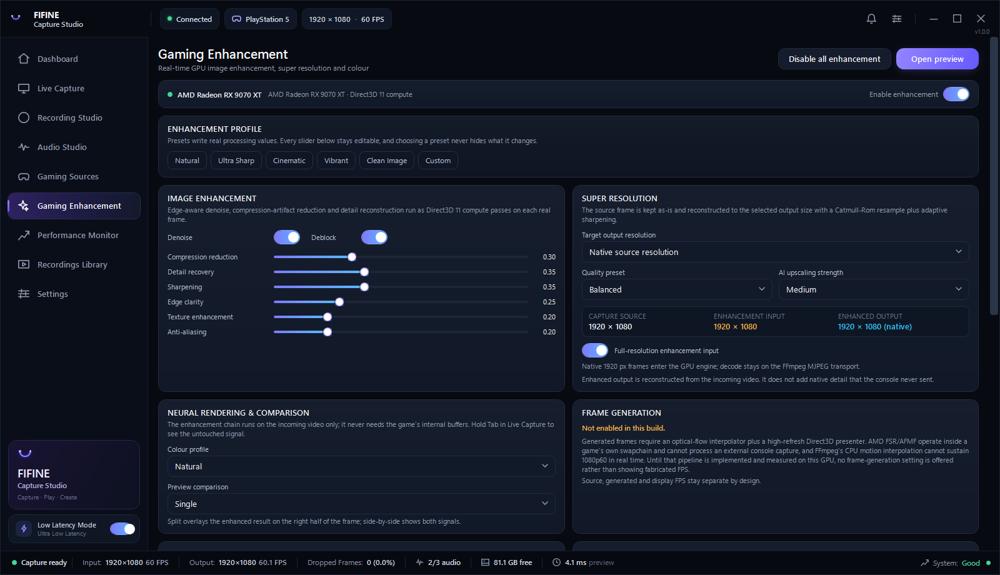
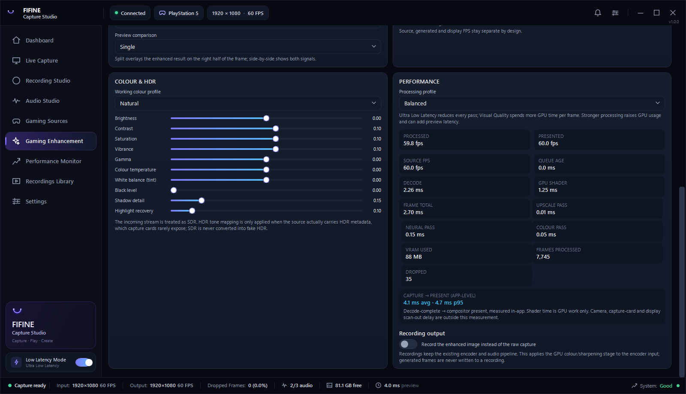

# Gaming Enhancement

FIFINE Capture Studio includes a real-time GPU image-enhancement pipeline for gameplay coming from
the PlayStation Remote Play backend, a capture card, a display or a window. It processes the incoming
video only — it never needs access to a game's internal render targets.


## What actually runs

```
capture pipeline ──MJPEG preview (native size when enhanced)──► CPU JPEG decode ──BGRA──► newest-frame slot
                                                                                        │
                          Direct3D 11 compute ◄──────── one upload per displayed frame ─┘
                          ├─ edge-aware denoise + deblock
                          ├─ detail / edge / texture reconstruction
                          ├─ colour grading (SDR)
                          └─ Catmull-Rom super resolution + adaptive sharpen
                          ──one readback──► preview / split / side-by-side (WPF compositor)
```

Every frame keeps its decode-completion timestamp and sequence number through the slot, the GPU
passes and the presentation notification, so the monitoring page can report where the time went.

* Implemented in `Core/Enhancement/` with Direct3D 11 compute shaders (HLSL, `cs_5_0`) through
  SharpDX. Every pass is a real GPU dispatch; source frames stay resident on the GPU across the whole
  chain, with exactly one upload and one readback per displayed frame. There is no GPU texture export
  yet, so the enhanced image is copied back to CPU memory to be shown by WPF.
* Shaders: `CSDenoise`, `CSGrade`, `CSUpscale`, `CSCopy` in `EnhancementShaders.cs`. No "AI" model is
  bundled or downloaded; the enhancement is a classical, deterministic GPU pipeline. That is stated
  plainly in the UI rather than being sold as a neural network.
* Super resolution targets: native, 1080p, 1440p and 4K. 6K/8K are not offered. The page always shows
  the original source resolution next to the enhanced output resolution and states that reconstructed
  output does not contain native detail the source never had.
* Colour: brightness, contrast, saturation, vibrance, gamma, temperature, tint/white balance, black
  level, shadow detail and highlight recovery. Input is handled as SDR; HDR is never invented.
* Profiles (Natural, Ultra Sharp, Cinematic, Vibrant, Clean Image, Custom) write concrete slider
  values, so nothing is hidden behind a preset.
* Comparison: single view, split (enhanced right half over the original) and side-by-side; holding
  **Tab** in Live Capture shows the untouched signal, releasing restores the enhanced view. The same
  hold-to-compare and quick toggle are available in the fullscreen gameplay preview.
* A panic control ("Disable all enhancement") switches processing off immediately.

## Preview resolution and the transport

The lightweight preview remains 1600 px wide. When Gaming Enhancement is enabled for the preview, the
capture pipeline now requests the **native source width** instead (capped at 3840 px so an 8K desktop
capture cannot turn the MJPEG transport into an unbounded stream). The resolution strip on the page
shows capture source, enhancement input and enhanced output separately, because they are three
different numbers.

| what | when |
| --- | --- |
| 1600 px preview | enhancement off, or full-resolution input disabled |
| native source width, ≤ 3840 | enhancement on and full-resolution input enabled (default) |
| native source width, called out as reduced | automatic fallback after sustained decode overload |



The transport is still FFmpeg → MJPEG → CPU JPEG decode. There is no D3D11VA decode of these frames
to tap into: the frames arrive as JPEG over a pipe, not as a hardware-decoded H.264/HEVC surface. A
true GPU-native path requires replacing the subprocess transport with in-process decode (or a
shared-handle decoder) and is not claimed here. The UI therefore says which route is active instead
of implying shared textures.

Because CPU JPEG decoding becomes the bottleneck of that transport at high sizes, the session watches
the measured decode time whenever the enhancement preview runs above 1600 px. If the moving average
stays above roughly 45% of the frame budget for 90 frames, it persists `FullResolutionPreview = false`,
shows a notice and restarts the preview at 1600 px. Recording and the encoded output are untouched by
this fallback: they always keep the full source resolution.

## Measured on the target hardware

AMD Radeon RX 9070 XT, driver 32.0.32029.2010. Headless benchmark on synthetic frames sized like the
real input, target equal to the source (Native super resolution), 120 frames, 2026-11-24:

| input → output | average | p50 | p95 | upload (CPU→GPU) | readback | VRAM |
| --- | --- | --- | --- | --- | --- | --- |
| 1920 × 1080 → 1920 × 1080 | 2.67 ms | 2.36 ms | 3.91 ms | 0.80 ms | 0.09 ms | 47 MB |
| 2560 × 1440 → 2560 × 1440 | 4.71 ms | 4.14 ms | 6.94 ms | 1.45 ms | 0.21 ms | 73 MB |
| 3840 × 2160 → 3840 × 2160 | 13.10 ms | 10.86 ms | 18.27 ms | 6.01 ms | 0.53 ms | 141 MB |

At 1440p and below the GPU ceiling is far above 60 fps. At 4K the average is 13.1 ms (≈76 fps), so a
4K60 enhancement preview is possible on this GPU, but the p95 of 18.3 ms leaves very little headroom and
the CPU upload is already 6 ms of it. This is why native input is a toggle with an automatic fallback
rather than an unconditional default.

Earlier measurement with the 1600 × 900 transport at a 1440p target: **3.8 ms average, p50 3.5 ms,
p95 4.8 ms**, and a live 1080p60 capture processed at **60.1 fps with 105 MB VRAM**. Those numbers
remain valid for the lightweight preview path.

The benchmark checks the result by reading back the frame and requiring real colour in the majority of
sampled pixels, not merely a non-empty buffer. That check is what caught an earlier D3D11 binding bug
where every pass wrote black; it now fails loudly if the pipeline stops producing image data.

Reproduce the headless benchmark (no UI, real GPU work, writes `%LOCALAPPDATA%\FifineCaptureStudioData\enhancement-bench.txt`):

```
FifineCaptureStudio.exe --enhance-bench 180
FifineCaptureStudio.exe --enhance-bench 120 --target 2160
FifineCaptureStudio.exe --enhance-bench 60 --image C:\path\frame.png --target 1440
```

`--image` runs a real decoded frame through the same engine and saves the processed result to
`enhance-bench-output.png` next to the report, which is the quickest way to eyeball quality changes.


The compact panel in Live Capture exposes sharpening, contrast and vibrance over gameplay, plus a link
to the full page and a single "Disable all enhancement" button.

## Freshness queue and latency telemetry

Enhanced frames are handed to the worker through a one-slot queue. A new frame **replaces** the queued
one when processing falls behind, instead of waiting behind stale work, so the pipeline can never build
seconds of backlog. Replaced frames are counted as dropped, and the processed frame keeps its original
sequence number, decode timestamp and age.

The page reports, with the measurement boundary stated in the UI:

* **Source / enhancement input / enhanced output** resolution.
* **Source FPS** (capture session), **processed FPS** and **presented FPS** as separate windows.
* **Dropped** frames (replaced queued frames) and **queue age** at the moment processing begins.
* **Decode** time, **GPU shader** time (sum of timestamp-query passes) and **frame total** (GPU + CPU
  readback wait + upload). Shader time is never labelled as total latency.
* **Capture → present** from decode completion to the compositor pass that paints the enhanced frame,
  with average and p95 over the last 240 samples. This is an in-app measurement: camera exposure,
  capture-card buffering and display scan-out are outside it, and it is not described as glass-to-glass.



The earlier build measured only the GPU staging copy as `ReadbackMs`. `Map` blocks until the copy has
finished, so that wall-clock wait is now measured separately (`ReadbackWaitMs`) and included in the
frame total, while the GPU copy keeps its own timestamp-query value. The enhanced worker now also raises
the presentation notification; previously only the plain preview path did, so enhanced latency could
never be sampled.

## Recording differences from the live preview

Enhanced recordings inject a real Vulkan/libplacebo filter chain into the existing encoder process
(`libplacebo=w=…:h=…:upscaler=lanczos:deband=…:brightness=…:contrast=…:saturation=…:gamma=…,cas=…`),
so scaling, colour grading and debanding happen on the GPU while the encoder, audio pipes, replay buffer
and file handling stay untouched. Generated frames are never written to a recording.

Live preview and recording are **not** the same implementation, and the UI does not claim they are:

| setting | live compute pipeline | recording filter |
| --- | --- | --- |
| brightness / contrast / saturation+vibrance / gamma | yes | yes (`libplacebo`) |
| debanding / denoise | edge-aware compute passes | `deband` only |
| sharpening | adaptive sharpen pass | `cas` |
| detail recovery, texture, edge clarity, anti-aliasing | yes | not expressible in this filter chain |
| temperature, tint/white balance, black level, shadows, highlights | yes | not applied (would need a LUT/curve stage) |
| output size | preview target | full recording resolution |

Recording always reads the full-resolution source through the existing encoder path, keeps the real
audio pipe and replay behaviour, and never receives generated frames. Aligning the remaining colour
stages would require a matching LUT chain in the recording filter; until that is validated visually,
the difference is documented rather than glossed over.

## Live frame generation — 2× RIFE (implemented)

A real 60 → 120 FPS path is implemented for the Gaming Enhancement page. It is separate from the
older recording-only FFmpeg `minterpolate` option: the live path uses a neural network and a native
presenter, and generated frames are never written into a recording.

### Engine and model

| Item | Value |
|---|---|
| Engine | ONNX Runtime 1.24.4, DirectML execution provider (AMD, Intel or NVIDIA) |
| Model | RIFE 4.25 lite, ONNX opset 17, float32, dynamic shape |
| Model size | 22,677,513 bytes |
| SHA-256 | `702802d0862ab78f2d72133c6bc3768e7e89b81756f7cd51d1055a2fe3d06577` |
| Source | `https://huggingface.co/t9749/rife-4.25-lite-onnx` (`rife_v425lite.onnx`) |
| Licence | MIT, © 2021 hzwer |
| Install | Explicit **Install 22 MB model** action on the card, checksum verified; never downloaded silently |
| Offline | Inference is fully local; no API, credits or network after installation |

`FIFINE_RIFE_MODEL` or `--model` can point at another copy. `--fg-bench` verifies that the session
really contains 488 DirectML nodes, that `GridSample` (the optical-flow warp) runs on the GPU, and
that the output differs from both inputs
and from a 50/50 cross-fade. That last check matters: a blend or duplicate would be rejected.

### Pipeline

```
PS5 Remote Play / capture card / test pattern
  → FFmpeg MJPEG decode (existing capture path)
  → optional Direct3D 11 enhancement
  → newest-frame slot (bounded; stale frames replaced, never queued)
  → RIFE 4.25 lite on DirectML at an internal 64-aligned size
  → DXGI flip-model fullscreen presenter
```

For each consecutive pair the pipeline presents the held first original, the neural midpoint, then the
second original when its due time arrives. Sequence gaps, dropped frames, resolution changes and
scene cuts reset temporal history instead of pairing unrelated images. A generated frame whose
inference finishes too late for its midpoint is skipped according to the latency preference
(Competitive is strictest, Smooth is most tolerant); originals keep flowing so latency never grows.

Internal inference sizes are deliberately below the presented resolution:

| Preset | Internal size | Presenter output |
|---|---:|---:|
| Performance | 768 × 448 | display size via DXGI stretch |
| Balanced | 896 × 512 | display size via DXGI stretch |
| Quality | 1024 × 576 | display size via DXGI stretch |

This is a genuine quality/performance fallback, not a pretence of native-resolution inference.

### Native presenter

A borderless Win32 window owns a Direct3D 11 flip-sequential swapchain on a dedicated thread. Frames
are copied into a dynamic BGRA texture, `CopyResource`d to the back buffer and presented with vsync;
DXGI stretches the internal buffer to the display. WPF is not in the 120 FPS path. The presenter
refuses to open on a display slower than 100 Hz and falls back to the existing WPF fullscreen preview
with an explanation. **Tab** holds original frames, **Esc** returns to the studio, and closing it
restores the normal UI.

### Measured on the RX 9070 XT

Synthetic motion, `--fg-bench`, 30 iterations after warm-up:

| Internal size | Inference avg | p95 | Total pipeline | Generated fps |
|---|---:|---:|---:|---:|
| 1024 × 576 | 12.47 ms | 13.79 ms | 14.80 ms (p95 16.36) | 67.6 |
| 896 × 512 | 10.25 ms | 11.51 ms | 12.06 ms (p95 13.28) | 82.9 |
| 768 × 448 | 8.52 ms | 9.56 ms | 9.94 ms (p95 11.45) | 100.6 |
| 1280 × 704 | 17.45 ms | 18.04 ms | 21.05 ms (p95 21.75) | 47.5 |

All 488 compute nodes run on DirectML. 198 `Gather`/`Cast`/`Concat`-class shape nodes remain on CPU
(sub-millisecond), while `GridSample` is on the GPU; without that, the real-time claim would be false.

One generated frame is needed per source pair, so a 60 FPS source needs about 60 generated fps — not
120 — plus enough headroom for scheduling and enhancement. 768 × 448 clears it, 1280 × 704 does not,
which is why 1440p-class native inference is not the default.

Live capture, 1920 × 1080 60 FPS generated test pattern with enhancement enabled, 280 Hz display:

| Preset | Presented | Source / generated | Inference avg / p95 | Missed deadlines | Queue age |
|---|---:|---:|---:|---:|---:|
| Performance | **120.5 FPS** | 1138 / 1136 | 11.80 / 12.97 ms | 6 | 2.7 ms |
| Balanced | 105.4 FPS | — | 14.59 / 15.61 ms | 66 | 2.5 ms |
| Quality | 88.3 FPS | — | — | 277 | 3.9 ms |

Only the Performance preset held the 120 FPS target in this live run; Balanced and Quality were
honest about falling short instead of hiding it. Repeated Performance runs measured 118.7–120.5
presented FPS, with process-local VRAM around 400 MB (enhancement, RIFE and presenter together).
The native presenter self-test (`--fg-present-test`) presented 360/360 synthetic frames at 119.6 FPS
with zero missed deadlines, which verifies cadence independently of capture.

### What is not claimed

* This was verified with a generated 60 FPS test pattern, **not** with a real PS5 Remote Play session
  or a capture card. Hardware validation is still outstanding.
* Generated frames are interpolated output, not native 120 FPS game rendering; console input latency
  and game simulation remain at 60 FPS.
* 3X, 4X and 240 FPS are not implemented and are not offered. The target list therefore contains
  only Auto (2× source) and 120 FPS.
* There is no HUD/UI protection yet. Fast camera motion, disocclusion, fine text and particle effects
  can produce the usual RIFE artifacts; scene cuts are detected and skipped rather than interpolated.
* Enhancement and RIFE do not share a GPU texture. Frames cross into the model as CPU float tensors
  (about 2.5 ms of pre/post work), and the presenter uploads each frame. This is a documented fallback,
  not zero-copy.
* Temporal interpolation needs the next source frame: the presenter path adds about one source
  interval (16.7 ms at 60 FPS) plus inference. The app does not automatically delay audio to match
  that small offset; per-channel audio delay and the existing A/V offset remain the manual controls.
  Recordings keep their own original video and audio timeline, so recording sync is unchanged.
* HDMI passthrough to a television remains the console's original signal. Generated frames appear
  only on the display driven by FIFINE's native presenter (or mirrored from it).

## FPS monitoring

FPS is reported with four separate values, never one shared counter:

* **Game FPS** — the game's own presentation rate. On PC this is a direct PresentMon measurement for
  the selected process; on PS5/Xbox/capture video it is a confidence-rated visual estimate.
* **Frame-gen output** — original source frames plus generated intermediate frames scheduled by the
  interpolator. The configured 120 FPS target is never displayed as a measurement.
* **Generated** — new intermediate frames actually produced per second.
* **Presented** — successful `Present` calls on FIFINE's native flip swapchain, sampled over 0.5 s.

### PC games: PresentMon

The app bundles no service and requires no injection. It downloads the pinned, MIT-licensed Intel
PresentMon **2.6.0** portable executable only when the user chooses **Download PresentMon**, verifies
its SHA-256 (`b2a706bc…188f1af`, 980,320 bytes), writes the licence next to it, and runs one persistent
console capture per selected process:

```
PresentMon.exe --process_id <pid> --output_stdout --no_console_stats --v1_metrics
              --stop_existing_session --terminate_on_proc_exit --session_name FIFINE_FPS_<pid>_<id>
```

Rows are parsed incrementally as UTF-16 CSV. Presents are grouped by `SwapChainAddress`; the primary
chain is the one with the most presents in its last two seconds, not merely the last chain touched,
so a launcher or overlay chain cannot replace the game. Game FPS is `(presents-1)/span` over a 2 s
window; frame time is the median `msBetweenPresents`; displayed FPS, when PresentMon supplies
`msBetweenDisplayChange`, is derived from its median interval. Dropped presents are counted from the
`Dropped` field. A stale or exited capture reports unavailable rather than a last-known value.

PresentMon needs ETW access. The UI explains that Windows' **Performance Log Users** group or an
elevated run may be required for another account's process, and never requests elevation silently.
If present events cannot be read, the cell stays **UNAVAILABLE**. The named ETW session is stopped
with `logman` when monitoring stops, because killing PresentMon alone leaves sessions that starve
later captures.

### Console and capture video: cadence estimate

Every decoded frame is reduced to a 64×36 BGRA sample. Per-pixel luma changes and 16×9 tile
luminance are compared, rather than a whole-frame hash: tile motion catches broad changes, while
per-pixel motion catches a thin moving object that barely shifts a 4×4 tile average. Thresholds
ignore ±1 codec noise, so a duplicated frame is still recognised. A 240-sample rolling
window (about 4 s at 60 FPS) gives a new-frame rate, snapped only when it is within 0.65 FPS of a whole
number. Confidence combines window coverage and first-half/second-half regularity (42% base, up to
36% coverage and 17% regularity, capped at 95%).

* Repeated frames are not new game frames, so 30 FPS inside a 60 FPS stream reports ≈30.
* 40 FPS inside a 60 FPS stream reports ≈40 from its two-new/one-repeat cadence.
* A full-rate 60 FPS stream is labelled **stream-limited**: the input cannot prove a faster game.
* A static scene returns the last stable estimate at reduced confidence for up to 10 s, then becomes
  temporarily unavailable.
* A hard scene cut discards the temporal window and shows **re-measuring** instead of a fake rate.

This is an estimate. It never claims to read the console's internal render counter, and HDMI/Remote
Play cannot reveal a game faster than the incoming stream.

### UI and measurement boundary

The compact overlay shows GAME FPS, FRAME GEN, GENERATED, PRESENTED and INPUT STREAM. It has four
corners, a 0.75–1.5 scale, and its visibility/position/scale persist in `FpsMonitorSettings`. It is a
WPF control on Dashboard, Live Capture and fullscreen preview, and a cached 3×5 block-text layer
composited directly into the native presenter's BGRA frames (a separate WPF window would add another
presentation path and cannot reliably sit above a flip-model swapchain). The Gaming Enhancement card
adds source, selected process, confidence, frame time, dropped/late counts, interpolation time, queue
state and display refresh.

### Tests and measured results

`FpsMonitorTests` covers 30/40/60-in-60 cadences, repeated frames, codec-sized noise, a thin moving
object on a static scene, static scenes, scene cuts, PresentMon CSV quoting/BOM, multi-chain primary
selection and settings normalisation. The full suite is **77 passing**.

A live 15 s Performance run with enhancement and the overlay enabled presented **1691 frames at
119.0 FPS** on the 280 Hz display, with 849 generated frames, 13.87 ms average inference (15.60 ms
p95), 11 missed deadlines and about 407 MB VRAM. The current machine's PresentMon session reported
all ETW present events lost (even elevated), so the PC-game path is validated by parser/chain unit
tests and a live source start, not by a real game's rows here; that limitation is shown as
**UNAVAILABLE** in the UI instead of a fabricated number. A real game on a machine with working
PresentMon ETW capture is still required to confirm DirectX 11/12/Vulkan rows end to end.

### Recording and passthrough

Live frame generation is presentation-only. Normal recordings stay at the configured recording FPS and
never receive generated frames; the recording output control is independent of the presenter. The
older recording-only `minterpolate` option still exists for users who explicitly select it, but it is
CPU encode-time interpolation and is not this feature.

## Limits

* The enhanced preview runs on CPU-decoded MJPEG frames from the FFmpeg subprocess. Native resolution
  input is available, but GPU-native decode/texture sharing is not, so the decode and one CPU→GPU
  upload per displayed frame remain.
* The 4K native path is GPU-feasible (13.1 ms average here) but upload-bound; the automatic fallback
  protects 60 fps sources when MJPEG decode cannot hold the budget.
* The normal preview and WPF fullscreen comparison still go through the WPF compositor. Only the
  120 FPS frame-generation presenter is a native DXGI surface.
* Enhancement adds GPU load and preview latency; Ultra Low Latency reduces or disables passes.
* HDR processing is not offered, because the capture paths do not expose reliable HDR metadata.
