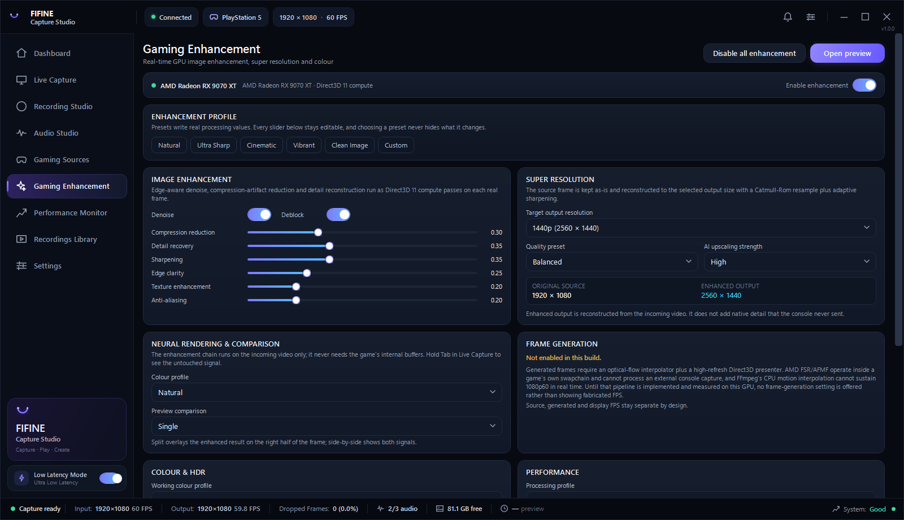
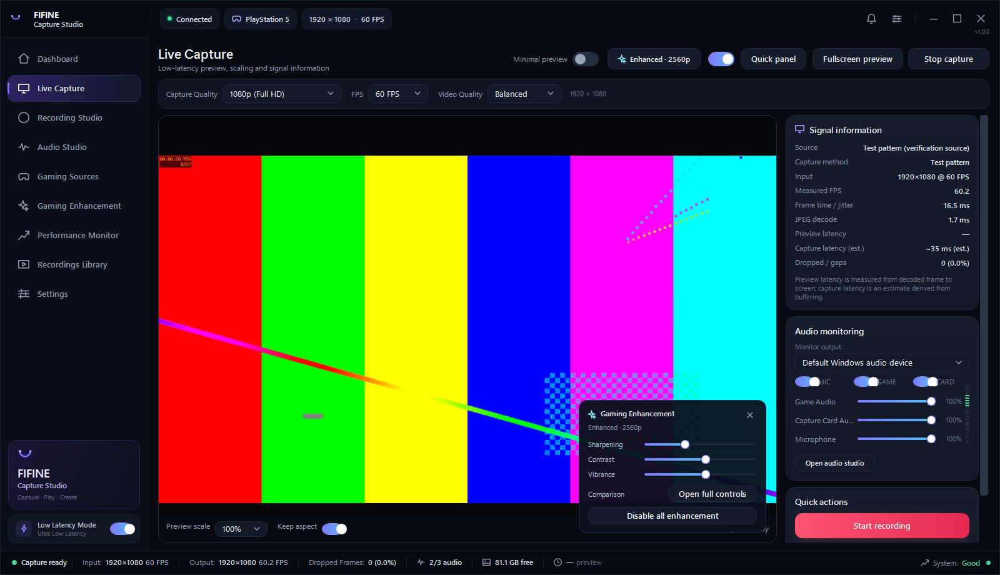

# Gaming Enhancement

FIFINE Capture Studio includes a real-time GPU image-enhancement pipeline for gameplay coming from
the PlayStation Remote Play backend, a capture card, a display or a window. It processes the incoming
video only — it never needs access to a game's internal render targets.



## What actually runs

```
capture pipeline ──MJPEG preview──► WPF decode ──BGRA──► Direct3D 11 compute
                                                         ├─ edge-aware denoise + deblock
                                                         ├─ detail / edge / texture reconstruction
                                                         ├─ colour grading (SDR)
                                                         └─ Catmull-Rom super resolution + adaptive sharpen
                                                         ──BGRA──► preview / split / side-by-side
```

* Implemented in `Core/Enhancement/` with Direct3D 11 compute shaders (HLSL, `cs_5_0`) through
  SharpDX. Every pass is a real GPU dispatch; source frames stay resident on the GPU across the whole
  chain, with exactly one upload and one readback per displayed frame.
* Shaders: `CSDenoise`, `CSGrade`, `CSUpscale`, `CSCopy` in `EnhancementShaders.cs`. No "AI" model is
  bundled or downloaded; the enhancement is a classical, deterministic GPU pipeline. That is stated
  plainly in the UI rather than being sold as a neural network.
* Super resolution targets: native, 1080p, 1440p and 4K. 6K/8K are not offered. The page always shows
  the original source resolution next to the enhanced output resolution and states that reconstructed
  output does not contain native detail the source never had.
* Colour: brightness, contrast, saturation, vibrance, gamma, temperature, tint/white balance, black
  level, shadow detail and highlight recovery. Input is handled as SDR; HDR is never invented.
* Profiles (Natural, Ultra Sharp, Cinematic, Vibrant, Clean Image, Custom) write concrete slider
  values, so nothing is hidden behind a preset.
* Comparison: single view, split (enhanced right half over the original) and side-by-side; holding
  **Tab** in Live Capture shows the untouched signal, releasing restores the enhanced view. The same
  hold-to-compare and quick toggle are available in the fullscreen gameplay preview.
* A panic control ("Disable all enhancement") switches processing off immediately.

## Measured on the target hardware

AMD Radeon RX 9070 XT, driver 32.0.32029.2010, 2560 × 1440 @ 280 Hz display, source 1600 × 900
preview frames, target 1440p, High upscaling strength:

| measurement | value |
| --- | --- |
| average frame time | 3.8 ms (≈265 fps ceiling) |
| p50 / p95 | 3.5 / 4.8 ms |
| GPU denoise pass | 0.11 ms |
| GPU colour pass | 0.03 ms |
| GPU upscale pass | 1.43 ms |
| VRAM used by the engine | ≈48 MB |
| real test-pattern frame, same target | 4.2 ms |
| 4K target (3840 × 2160) | p50 6.4 ms, p95 7.6 ms |

Measured during a live 1080p60 capture in the running application: **60.1 processed fps, 3.81 ms per
frame, 1.32 ms upscale, 0.10 ms denoise, 105 MB VRAM** — i.e. the preview path keeps up with a 60 fps
source on this GPU.

The benchmark checks the result by reading back the frame and requiring real colour in the majority of
sampled pixels, not merely a non-empty buffer. That check is what caught an earlier D3D11 binding bug
where every pass wrote black; it now fails loudly if the pipeline stops producing image data.

Reproduce the headless benchmark (no UI, real GPU work, writes `%LOCALAPPDATA%\FifineCaptureStudioData\enhancement-bench.txt`):

```
FifineCaptureStudio.exe --enhance-bench 180
FifineCaptureStudio.exe --enhance-bench 120 --target 2160
FifineCaptureStudio.exe --enhance-bench 60 --image C:\path\frame.png --target 1440
```

`--image` runs a real decoded frame through the same engine and saves the processed result to
`enhance-bench-output.png` next to the report, which is the quickest way to eyeball quality changes.



The compact panel in Live Capture exposes sharpening, contrast and vibrance over gameplay, plus a link
to the full page and a single "Disable all enhancement" button.

## Recording

`Settings → recording output` (in the Performance card) chooses whether recordings use the raw
capture or the enhanced image. Enhanced recordings inject a real Vulkan/libplacebo filter chain into
the existing encoder process (`libplacebo=w=…:h=…:upscaler=lanczos:deband=…:brightness=…:contrast=…:
saturation=…:gamma=…,cas=…`), so scaling, colour grading and debanding happen on the GPU while the
existing encoder, audio pipes, replay buffer and file handling stay untouched. Generated frames are
never written to a recording.

## Frame generation — not enabled

No 2X/3X/4X setting is offered, because the project does not yet have a frame-generation pipeline
that could honestly display what it generates:

* **AMD FSR / AFMF** operate inside a game's own swapchain through the driver and cannot process an
  external console or capture-card video stream.
* **FFmpeg `minterpolate`** is CPU motion interpolation and cannot sustain 1080p60 in real time; the
  user brief explicitly excludes shipping it as "AI frame generation" (the older recording-only
  auto-interpolation setting is separate and is not presented as this engine).
* A genuine implementation needs a GPU optical-flow estimator, bidirectional warping with occlusion
  handling, scene-cut detection and, critically, a **high-refresh Direct3D swapchain presenter** —
  WPF's compositor cannot present 120–240 generated frames per second, so generating them into the
  existing preview would show fabricated numbers rather than real output.

The FRAME GENERATION card in the app states this; it contains no decorative controls and no invented
FPS. The measured headroom above (3.8 ms per frame at 1440p) is the budget such a pipeline would have.

## Limits

* The enhanced preview runs on the existing 1600 px MJPEG preview frames, not the full-resolution
  decoder output; recording enhancement is the full-resolution path.
* Enhancement adds GPU load and preview latency; Ultra Low Latency reduces or disables passes.
* HDR processing is not offered, because the capture paths do not expose reliable HDR metadata.
